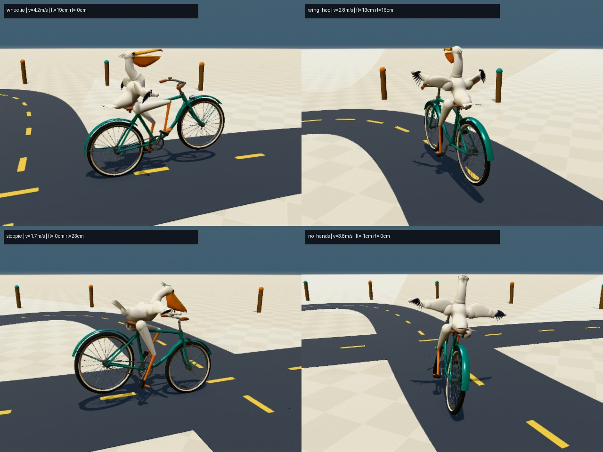

# Pelican Riding a Bicycle — MuJoCo + RL Benchmark

> **100% AI-Generated Project (Gemini 4 Hydrogen)**  
> This entire repository—including the 3D Blender-sculpted meshes, PBR textures, MuJoCo MJCF rigging, closed-chain pedal kinematics, LQR + DAgger + PPO reinforcement learning controller, stunt state machine, MuJoCo Studio plugin UI, automated test suite, and the separate client-side WebAssembly browser port—was generated end-to-end by **Gemini 4 Hydrogen**.
>
> **Why this repo exists:** It was created as a capability benchmark to test what **Gemini 4 Hydrogen** can build and iterate on autonomously. A previous attempt at this same task with **Gemini 3.8 Flash** performed terribly, so this project highlights a major generational leap in multi-step 3D asset modeling, physics debugging, and control engineering.

**[Live Browser Demo (GitHub Pages — MuJoCo WASM)](https://hrithikramprasath.github.io/pelican-bike/)**  
*(Hosted from a completely separate orphan `gh-pages` branch running official `@mujoco/mujoco@4.0.1` WebAssembly + Three.js directly in your browser.)*



---

## Overview

A physics-accurate beach cruiser bicycle ridden by an articulated pelican in **MuJoCo 4.0.1**, complete with closed-loop balancing, continuous Figure-8 / circle / cruise / manual path tracking, knockable slalom cones, and six interactive button-triggered stunts:

- **Turbo Boost!** — Aero-tuck acceleration burst up to ~`5.8 m/s` while hugging corners safely
- **Wheelie!** — Dynamic front-wheel lift (`~30.8 cm` peak wheel height on Figure-8), airborne balance hold, and clean touchdown
- **Wing-Flap Hop!** — Synchronized wing downstroke aerodynamic lift launching both wheels cleanly off the asphalt
- **Stoppie!** — Modulated front-brake pulse pitching the rear wheel into the air before rolling out smoothly
- **No-Hands!** — Wings spread wide for balanced hands-free riding
- **S-Carve!** — Rhythmic sinusoidal lane weaving with clean re-centering

Plus live interactive controls (`Flap Wings!`, `Snap Beak!`, `Nod & Bell`, `Push Left`, `Push Right`, `Reset Ride`), wing pose presets (`Hold Handlebars`, `Spread Glide`, `Flap Wings`), environment switching (`Coastal Boardwalk`, `Slalom Cones`, `Studio Checker`), camera presets (`Orbit`, `Side`, `Beak Cam`, `Chase`), a toggle to compare the **Trained PPO MLP** against the **LQR Baseline**, and live ImPlot telemetry.

---

## Repository Structure (Two Completely Separate Branches)

- **`main` branch (this branch)** — Native **Python + MuJoCo Studio + RL training & verification** workspace:
  - [`assets/pelican_bicycle/model.xml`](assets/pelican_bicycle/model.xml) — Articulated bicycle & pelican MJCF (`24` bodies, `29` joints, `23` actuators including `drive_motor` and `front_brake`, `mjEQ_CONNECT` closed foot-to-pedal kinematic loops, `2:1` rear wheel chain constraint, `30` `.obj` meshes, `14` 4-channel PBR texture sets: `basecolor`, `roughness`, `metallic`, `normal`)
  - [`track.py`](track.py) — Continuous phase-locked Figure-8 Lissajous (`FIG8_A = 7.5`, `FIG8_B = 3.8`), circle (`CIRCLE_RADIUS = 4.6`), and cruise road-frame math `(e_lat, e_psi, k0..k4)` with heading disambiguation at the `(0, 0)` Figure-8 crossover and curvature-aware speed capping (`safe_corner_speed`)
  - [`policy.py`](policy.py) — Pure-NumPy `22 -> 96 -> 96 -> 4` `tanh` MLP (`PelicanPolicy`), `22`-dim observation builder, and speed-scheduled LQR + vector-field supervisor (`lqr_supervisor_batch`)
  - [`train_policy.py`](train_policy.py) — Two-phase controller trainer: finite-difference MuJoCo LQR gain synthesis across `[1.8, 2.5, 3.4, 4.5, 5.8, 6.5] m/s`, DAgger warm-start, and parallel `mujoco.batch.Batch` PPO fine-tuning
  - [`trained_policy.npz`](trained_policy.npz) — Saved trained actor weights, Welford normalization statistics, and LQR gain tables (`iter = 40`, `eval_err_m = 0.205 m`, `eval_surv_s = 30.0 s`)
  - [`sim_plugin.py`](sim_plugin.py) — MuJoCo Studio `SimPlugin`: procedural scene construction via `MjSpec`, `50 Hz` learned policy inference (`POLICY_SUBSTEPS = 10` at `dt = 0.002 s`), out-of-distribution LQR safety shield, queued/interruptible trick state machine, and kinematic foot/pedal leveling
  - [`viewer_plugin.py`](viewer_plugin.py) — MuJoCo Studio `ViewerPlugin`: Dear ImGui controls + ImPlot telemetry graphs
  - [`messages.py`](messages.py) — Snapshot/event dataclasses (`RideConfig`, `ActionEvent`, `RideTelemetry`) shared between simulation and viewer plugins
  - [`verify_all.py`](verify_all.py) — 10-part automated headless verification suite
- **`gh-pages` branch (separate orphan branch)** — Rewritten standalone static browser app built specifically for **GitHub Pages** (`index.html`, `app.js`, `styles.css`, `trained_policy.json`, portable scene XMLs, meshes/textures) using Google DeepMind's `@mujoco/mujoco@4.0.1` WASM engine and Three.js PBR rendering directly on the client with zero backend server required.

---

## Running Locally (MuJoCo Studio & Tests)

### 1. Environment Setup

Requires Python `>= 3.10` with MuJoCo (`>= 4.0.1`), `mujoco-studio` (`>= 4.0.1`), `numpy`, and `scipy` (for example in a `mujoco-studio` Python environment):

```bash
python -m venv .venv
source .venv/bin/activate
pip install "mujoco>=4.0.1" mujoco-studio numpy scipy
```

### 2. Run the Automated Verification Suite

```bash
python verify_all.py
```

Observed benchmark results on the current `trained_policy.npz` + `sim_plugin.py`:

| Check | Result |
| --- | --- |
| 180s Figure-8 Endurance | Upright full `180 s`, `547.91 m` ridden, `0.207 m` mean road error (`0.547 m` max), `23.45 deg` max lean |
| Sequential 6 Tricks (Figure-8) | All 6 upright: `Turbo Boost` (`5.37 m/s`), `Wheelie` (`30.84 cm` front lift), `Wing-Flap Hop` (`15.96 cm` full airborne lift), `Stoppie` (`19.56 cm` rear lift), `No-Hands` (`1.108 rad` wing yaw), `S-Carve` |
| High-Speed Cruise (`5.8` & `6.0 m/s` + Boost) | Upright, `1.45–1.78 deg` max lean |
| Circle Left & Right (`5.5 m/s` + 6 tricks) | Upright across multi-lap tests, all 6 tricks executed |
| Manual Steer (`+0.7`) + 6 Tricks | All 6 upright & executed |
| 7 Mid-Air / Active-Trick Interrupts | `wing_hop -> {stoppie, wheelie, wing_hop}`, `stoppie -> {turbo_boost, wheelie}`, `wheelie -> {stoppie, wing_hop}` all upright |
| Far Off-Track Recovery | Recovered cleanly from `(0, 8)`, `(15, 0)`, and `(-12, 6)` with `0.029–0.312 m` final road error |
| Push Disturbances + Slalom Cones + LQR | Survived lateral pushes (`Push Left` / `Push Right`), slalom cones, and LQR baseline checks |

### 3. Launch Interactive MuJoCo Studio Viewer

Run your MuJoCo Studio daemon against this workspace directory (so `sim_plugin.py`, `viewer_plugin.py`, and `messages.py` hot-load cleanly).

### 4. Re-train the Policy (Optional)

```bash
python train_policy.py
```

Runs LQR gain table synthesis, DAgger initialization, and parallel `mujoco.batch.Batch` PPO training to regenerate `trained_policy.npz`.

---

## AI Authorship Notice

All code, 3D geometry/textures, physics parameters, reward shaping, verification harnesses, and documentation in this repository were generated by **Gemini 4 Hydrogen** as an autonomous capability evaluation. Please review physics/control code before using it in safety-critical applications.
